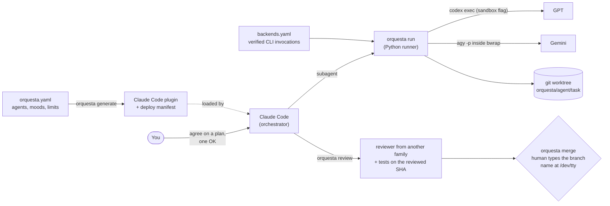
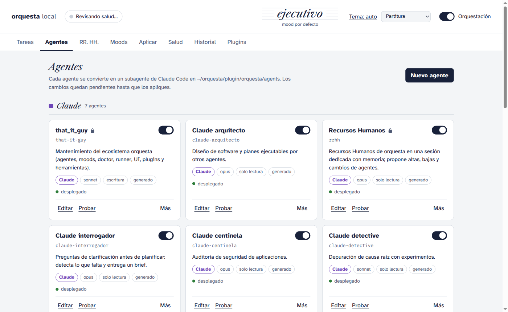
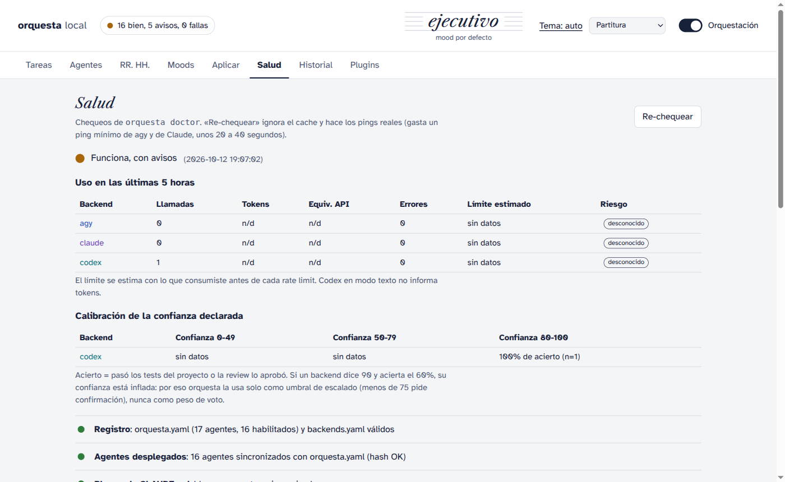

# orquesta

[](https://github.com/Luca-Camiscia/orquesta/actions/workflows/ci.yml)


**Coordinates Claude, GPT and Gemini on programming tasks, keeps their changes apart from yours, and
requires a review by another model plus your approval before anything is merged.**

Claude Code plans the work and delegates it to GPT (through the Codex CLI) and Gemini (through the
Antigravity CLI, `agy`), using the subscriptions you already pay for: no API keys. A Python runner sits
between the orchestrator and the other models and enforces in code, not in the prompt, what an LLM
should not be trusted to decide by itself:

- a **read-only** agent cannot leave changes behind (OS sandbox on Linux, plus a before/after check of
  the git state everywhere);
- a **write** agent works in its own `git worktree` and branch, with a sandbox that keeps your checkout
  read-only on Linux;
- a change is reviewed by **a different model family** than the one that wrote it, with the project
  tests run on the exact commit under review;
- nothing reaches your branch without a **human typing the branch name at the terminal**, and a diff that
  deletes assertions or skips tests is blocked even if the reviewer approved it.

**In use:** in its first week orquesta delegated 85 runs to GPT and Gemini and flagged two read-only
violations ([case study](docs/case-study.md)); 33 of the project's ~200 commits were written by GPT agents
and merged after review by another model family. A small [evaluation](eval/README.md) with hidden tests
(138 real runs, 71 of them re-scorable offline from their traces) found that a second critical pass is
what helps: a single agent passed 23/35, the cross-family review loop 33/36, and the same agent
reviewing its own fix with a checklist 36/36 at about half the loop's time.

> UI, CLI messages and agent prompts are in Spanish (the tool is built for daily use in Spanish). The
> code, this page and the [demo](examples/demo) are readable without it. Versión en español: [README.es.md](README.es.md).

## See it in 60 seconds (offline, no accounts)

```bash
git clone https://github.com/Luca-Camiscia/orquesta && cd orquesta
uv run python examples/demo/run_demo.py
```

The demo creates a throwaway project with a pricing bug and runs the **real** orquesta code path end to
end. Only the model CLIs are replaced by a [scripted stand-in](examples/demo/demo_backend.py), so it
costs nothing and is deterministic. It is also part of the test suite. Abridged output (the CLI answers in Spanish):

```text
── 3. Delegate the fix to a write agent
   $ orquesta run codex-forjador --cwd …/shop --task fix-discount   → exit 0
     rama: orquesta/codex-forjador/fix-discount        # its own branch and worktree; main untouched
── 4. A read-only agent that writes anyway
   $ orquesta run codex-critico --cwd …/shop   → exit 7
     ESTADO: VIOLACION_READ_ONLY — el árbol cambió durante una corrida read-only (…): notes.txt
── 5. Rate limit
   $ orquesta run codex-critico --cwd …/shop   → exit 75
     ESTADO: RATE_LIMIT — el backend reportó límite de uso o de cuota
── 6. Cross-family review                    # author was GPT → reviewer is Gemini
   $ orquesta review orquesta/codex-forjador/fix-discount   → exit 0
     { "revisor": "gemini-revisor", "veredicto": "APROBAR", "tests_ok": true, "sha_revisado": "4c4f1cb" }
── 7. Merge needs a human
   $ orquesta merge orquesta/codex-forjador/fix-discount   → exit 3
     { "estado": "NECESITO_CONFIRMACION", "comando": "orquesta merge … --confirm" }
── 9. An agent that "fixes" tests by deleting an assertion
   $ orquesta merge orquesta/codex-forjador/make-tests-green --confirm   → exit 3
     { "estado": "BLOQUEADO", "razones": ["… debilita los tests: tests/test_prices.py: assert eliminado …"] }
```

## How it works



1. **Registry → plugin.** [`orquesta.yaml`](orquesta.yaml) declares 17 agents (16 enabled) (role, backend, model,
   read-only/write, isolation, when to route to them). `orquesta generate` validates it with pydantic and
   renders a local Claude Code plugin: one subagent per agent, slash commands, a skill and hooks. A
   `SessionStart` hook injects the routing table and orchestration rules into every session.
2. **Thin wrappers, real runner.** Agents backed by GPT or Gemini are cheap Claude wrappers whose only job
   is to call `orquesta run <agent>`. The runner builds the command from
   [`backends.yaml`](backends.yaml) (the one place with the Codex and Gemini invocations; the exceptions are
   native `claude -p` calls for meetings and model discovery), applies the sandbox, the worktree,
   timeouts and per-backend concurrency limits, classifies the outcome and saves the full output with its hash.
3. **Review and merge are CLI commands, not prompts.** `orquesta review` runs the project tests in the
   worktree and asks a read-only agent of another model family for a verdict. `orquesta merge` only merges
   the commit that was reviewed *and* tested; any new commit invalidates both.

## Guarantees and where they live

| Guarantee | Mechanism | Code | Tests |
|---|---|---|---|
| Read-only agents leave no tracked changes | `bwrap` with `/` read-only, a private empty `/tmp`, the two state dirs the CLI needs writable, and the whole repository (including `.git`) re-mounted read-only on top (Gemini); `--sandbox read-only` (Codex); plus a SHA-256 of `git status`, worktree and index diffs, dirty-file signatures, `HEAD` and every ref except task branches (`orquesta/*`, which parallel runs move), before and after each run. Files ignored by git (caches, `.venv`) are out of scope by design | [`runner.py`](src/orquesta/runner.py) `_sandbox_prefix`, `tree_state` | `tests/test_runner.py` (includes a real `bwrap` write attempt) |
| Write agents are isolated | One `git worktree` per task on `orquesta/<agent>/<task>`, and a private `TMPDIR` per run. Sandboxes keep the original checkout read-only: Gemini's `bwrap` gets a private `/tmp`, re-mounts the repository and its git dir read-only and only re-opens the worktree, its git dir and the object store; Codex's `workspace-write` runs with the shared `/tmp` excluded (verified: without it, a checkout under `/tmp` was writable). The runner also compares the checkout before and after each run (ignoring task branches, which parallel runs move) and attaches a warning if it changed, without blocking, since you may be working there at the same time | [`runner.py`](src/orquesta/runner.py) `_sandbox_prefix`, `run`; [`backends.yaml`](backends.yaml) | `tests/test_runner.py` (includes real `bwrap` writes inside and outside the worktree) |
| No self-review | The reviewer must be read-only, from a different backend family than the author and installed; the prompt carries no author name or worktree path. The verdict is the last `Veredicto:` line outside code blocks, and any other verdict anywhere in the reply makes it ambiguous, which does not approve | [`revision.py`](src/orquesta/revision.py) `elegir_revisor`, `validar_revisor` | `tests/test_cli_review_merge.py` |
| Merge only what was reviewed | Merge requires branch tip == reviewed SHA == tested SHA, clean trees and the base still an ancestor. The destination cannot have advanced since the base unless the task already incorporates its current tip: update the branch and review it again, or explicitly force the merge. If the diff was too long for the review prompt, the reviewer gets the full file list and the merge is blocked until you confirm | [`cli.py`](src/orquesta/cli.py) `cmd_merge`, `worktrees.merge_sha` | `tests/test_cli_review_merge.py` |
| A human confirms | `--confirm` reads an exact text from `/dev/tty`; without a TTY the CLI returns `NECESITO_CONFIRMACION` (exit 3) and the command to run in a second terminal. No flag or env var skips it | [`confirmar.py`](src/orquesta/confirmar.py) | `tests/test_confirmar.py`, `tests/test_cli_review_merge.py` |
| The usual ways of weakening tests are caught | Diff heuristics over the full diff: deleted tests or assertions, new `skip`/`xfail`, trivial asserts (`assert True`, `x == x`), pytest config that deselects. It is a heuristic: replacing an assertion with a weaker one (`== 80` → `>= 0`) is left to the reviewer | [`revision.py`](src/orquesta/revision.py) `tests_debilitados` | `tests/test_caracterizacion_revision.py` |
| Protected agents and privilege escalation | `generate` diffs against what is *deployed* and refuses read-only → write, new tools or plugins, prompt changes of protected agents without `--confirm` | [`guard.py`](src/orquesta/guard.py) | `tests/test_guard.py` |
| Delegation loops end | The runner atomically counts runs per task and blocks the ninth after 8 runs, even without orchestrator annotations. Progress annotations still require re-planning after 2 rounds without progress and block new runs at 4 (or 6 total rounds), with `ESTADO: BLOQUEADO` | [`ledger.py`](src/orquesta/ledger.py), `runner.run` | `tests/test_ledger.py`, `tests/test_runner.py` |

**Threat model.** The adversary is a model that follows rules but makes mistakes, not a malicious one. A
model with shell access under your user id can defeat any local control (for example by opening a pty).
The goal is that a mistake never ends in a silent merge or registry change, and that a deliberate bypass
leaves a trace in git, the changelog and the deploy manifest. Details in
[`docs/plugin-plan.md`](docs/plugin-plan.md) (Spanish). A worked example of finding and closing holes in
these guarantees: [`docs/case-study.md`](docs/case-study.md).

**Known gaps.** The OS sandbox exists only on Linux; elsewhere the runner falls back to detection. Native
Claude subagents do not go through the runner. If a project has no test command configured
(`[worktree] tests = "…"` in `.orquesta/proyecto.toml`), merge still requires a cross-family approval and
your confirmation, but there is no test evidence: configure it.

**Not covered: untrusted content.** The threat model above assumes you trust the repositories and files
you point orquesta at. In particular:
- The `setup` and `tests` commands in `.orquesta/proyecto.toml` run with `bash -c` as your user, outside
  any sandbox. Treat that file like a Makefile: read it before running orquesta on a repository you did
  not write.
- Tests run on the code a write agent produced, also outside the sandbox (a `conftest.py` the agent added
  runs with your permissions during `orquesta review`). Read the diff before reviewing code from a run you
  do not trust.
- Gemini's `bwrap` sandbox limits writes, not reads or network: it can read the rest of your home
  directory (including credential files) and reach the internet, and `~/.cache` and `~/.gemini` stay
  writable. A prompt injection in the content it reads could exfiltrate data. Do not hand it untrusted
  documents on a machine with secrets you care about.
- The local UI accepts the same confirmations as `--confirm` from the browser, authenticated by a token
  embedded in the page it serves on `127.0.0.1`. Another process running as your user can fetch that
  page, so the TTY check does not protect against local processes while `orquesta ui` is running.

## Screenshots

The local panel (`orquesta ui`, bound to 127.0.0.1 with a per-session token, Host/Origin checks and a CSP):




## Install

Requirements: Linux, Python 3.11+, [uv](https://docs.astral.sh/uv/), git, `bubblewrap`,
[Claude Code](https://docs.anthropic.com/claude-code), and at least one of the
[Codex CLI](https://github.com/openai/codex) or Google's Antigravity CLI (`agy`, a single binary; see the
[Antigravity docs](https://antigravity.google/docs)), logged in with your subscription. Verified versions
and invocations are in [`docs/headless.md`](docs/headless.md) and [`docs/verification.md`](docs/verification.md); `orquesta doctor` checks each session
(`codex login status`, `agy models`).
The bundled registry uses both; with only one installed, reviews fall back to an installed backend of
another family (Claude counts), and `orquesta doctor` flags a backend CLI that is missing or logged out.
To run without one of them, set `enabled: false` on its agents in `orquesta.yaml` and regenerate (disabling
an agent counts as a registry change the guard asks you to confirm).

```bash
git clone https://github.com/Luca-Camiscia/orquesta ~/orquesta && cd ~/orquesta
uv run pytest                    # ~1,200 tests, about a minute, no network and no model calls
uv tool install -e .             # puts `orquesta` on your PATH
orquesta doctor --skip-live      # checks binaries, auth, registry and deploy without spending quota
orquesta migrar corte --confirm  # installer: generates the plugin and registers it with Claude Code
```

`migrar corte` is idempotent and asks you to type a confirmation word at the terminal; `migrar rollback
--confirm` undoes it. Then open Claude Code in any git project: the orchestrator context is injected on
session start and the agents appear as `orquesta:<name>`.

Day to day: edit `orquesta.yaml` (or use the panel), `orquesta generate -m "message"` (backup → write →
test suite → changelog → commit, restoring on failure), then `/reload-plugins` in Claude Code.

## Main commands

| Command | What it does |
|---|---|
| `orquesta run <agent> --cwd DIR [--task SLUG]` | Delegate (prompt on stdin) to the agent's backend with all runner rules |
| `orquesta review <branch>` | Tests on the branch tip + verdict from another model family |
| `orquesta merge <branch> --confirm` | Merge the reviewed SHA after a TTY confirmation and the merge guards |
| `orquesta reunion --modo critica --participantes a,b,c` | Multi-model "meeting": blind first round, anonymized critique, judge |
| `orquesta doctor` | Deterministic health checks (binaries, auth, versions, deploy drift, quota) |
| `orquesta usage` / `orquesta ledger` | Per-agent usage and latency; progress ledger per task |
| `orquesta ui` | Local panel |

Every command that the orchestrator consumes answers with a versioned JSON envelope
([`docs/cli-json.en.md`](docs/cli-json.en.md)). Full reference in [README.es.md](README.es.md#comandos).

## Design notes

The full rationale is in [`docs/design.md`](docs/design.md); the highlights:

- **Backends are data.** CLI invocations were verified by hand and recorded with evidence in
  [`docs/headless.md`](docs/headless.md). For example, `agy --mode plan` turned out *not* to be read-only,
  which is why Gemini runs inside `bwrap` instead of trusting a flag.
- **Literature-informed rules.** Meetings start with an independent blind round and anonymize peers
  (debate gains come mostly from voting; models conform to peers), reviewers can only reject with a
  concrete file:line finding, and declared confidence is used as an escalation threshold, never as a
  vote weight (it is calibrated per backend in the panel). The papers and what was taken from each are in
  [`docs/investigacion.md`](docs/investigacion.md).
- **Tests never touch your real config.** Every test runs against temporary directories and a
  [fake backend](tests/fake_backend.py) process; CI runs the suite on Python 3.11–3.13 with a real `bwrap`.

## How it was built

I designed orquesta and directed its development with Claude Code, and from early on I used orquesta to
build itself: 33 of the ~200 commits (prefixed `orquesta(codex-forjador)`, `orquesta(codex-tester)`, …)
were written by delegated GPT agents in their own worktrees and merged after review by another model
family. The plans with the decisions behind each stage are in [`PLAN.md`](PLAN.md) and
[`docs/plugin-plan.md`](docs/plugin-plan.md), and every change to the generated plugin is logged in
[`CHANGELOG.md`](CHANGELOG.md).

## Layout

```
orquesta.yaml, backends.yaml   source of truth: agents and verified backend invocations
src/orquesta/                  schema, generator and plugin renderer, runner, worktrees, review/merge,
                               confirmation, hooks, doctor, meetings (chat), HR heuristics, usage, UI
tests/                         pytest suite (temporary dirs, fake backend process)
examples/demo/                 offline end-to-end demo
docs/                          backend evidence, JSON contract, plugin design and threat model, research
```

No license is granted: the code is public to be read and evaluated.
